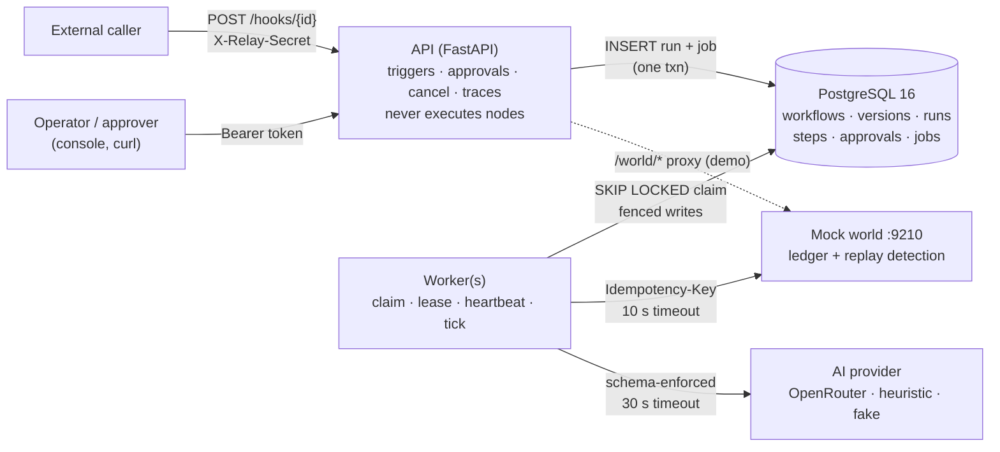
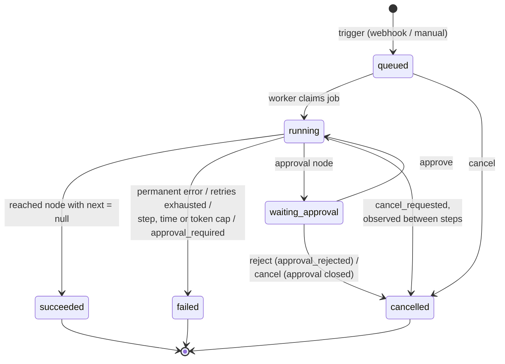

# Relay: AI Workflow Orchestrator

Relay is a durable workflow engine for operations teams. A webhook or API call starts a run. Typed nodes then classify the request with AI, branch on the result, call external services, and wait for a human to approve. Each step is persisted before the engine moves on, so a worker killed with `SIGKILL` resumes from its last completed step. Side effects carry stable idempotency keys, and the mock world's ledger shows that each one happened exactly once. The engine itself enforces approval gates and run caps, so no AI output or prompt-injected payload can get around them. The stack is Python 3.12, FastAPI, PostgreSQL 16 and a no-build console, all started with one `make up`.

**Key highlights**

- **Exactly-once side effects across crashes.** A three-phase tick (persist, execute, commit) plus `Idempotency-Key: {run_id}:{node_id}:{sequence}`. Proven by a `SIGKILL` drill and by a fault injected into the real crash window (after the HTTP call, before the commit).
- **One Postgres for both the store and the queue.** Steps and job state change in the same transaction. Workers claim jobs with `FOR UPDATE SKIP LOCKED`, leases, heartbeats and fencing, so multiple workers are supported by design.
- **AI output you can branch on.** Every AI response is checked against the node's JSON Schema, with one repair retry that includes the validation errors. If the output is still invalid, the step fails cleanly. Token usage is recorded for every call.
- **Five layers of injection defence.** The main guarantee is the approval gate, which is enforced as data in the engine. `pay_inject_001` cannot reach the refund, and `pay_inject_002` cannot exfiltrate data through `summary`.
- **Bounded runs.** Runs are capped by step count (`max_steps`), wall-clock time (`timeout_seconds`, which excludes time spent waiting for approval) and AI tokens (`max_ai_tokens`). `wf_runaway` stops at step 12.
- **Immutable versions and per-run snapshots.** Editing or republishing a workflow never changes a run that is in flight or already finished.
- **Complete traces.** Each step records its resolved input, output, every attempt (including attempts interrupted by a crash), timing, tokens, idempotency key and the gate decision.

---

## Quick start (Docker)

```bash
git clone https://github.com/Sreekar-33/relay-ai-orchestrator.git && cd relay-ai-orchestrator
cp .env.example .env              # default AI provider is "heuristic": offline, no API key needed
make up                           # docker compose up -d --build, then waits for /health
open http://localhost:8080/console   # token: relay-demo-token
```

| Service | Port | Notes |
|---|---|---|
| API + console | 8080 | console at `/console`, OpenAPI docs at `/docs` |
| Mock world | 9210 | `scripts/mock_world.py` from the pack (ledger and fault injection) |
| PostgreSQL 16 | 5433 (host) | holds all state and the job queue |

Other targets: `make down`, `make reset` (wipes volumes and starts again), `make logs`, `make smoke`, `make drill`, `make drill-crash`, `make chaos`, `make db` + `make test`.

**To use a real model** (recommended for demo steps 2 and 3): in `.env`, set `RELAY_AI_PROVIDER=openrouter`, `OPENROUTER_API_KEY=...` and optionally `RELAY_AI_MODEL` (default `openai/gpt-4o-mini`). Then run `make up`. `GET /health` reports which provider is in use.

---

## Reproduce the demo

Quickest: `bash scripts/demo_triage.sh` sends all five triage payloads through the webhook and prints each classification, risk flags, path and the ledger. For step-by-step use, set up these shell helpers (they need `curl` and `jq`):

```bash
export RELAY=http://localhost:8080 AUTH="Authorization: Bearer relay-demo-token"
body() { curl -s -H "$AUTH" $RELAY/samples | jq -c --arg id "$1" '.[] | select(.id==$id) | .body'; }
triage() { curl -s -X POST $RELAY/hooks/wf_support_triage -H 'X-Relay-Secret: whsec_triage_501' \
             -H 'Content-Type: application/json' -d "$(body $1)"; }
```

| # | Demo step (problem statement) | Command / console action | Expected result |
|---|---|---|---|
| 1 | Start the stack and show the seeded workflows | `make up`, then open `/console` → Workflows | `wf_support_triage`, `wf_expense_approval`, `wf_slow_fulfillment`, `wf_runaway` are published, plus 2 extra demo workflows |
| 2 | Normal triage run | `triage pay_001`, then open the run in the console | `classify` (ai: schema-valid output, tokens shown) → `route` false → `notify_support` posts to `#support`. One `chat.message` ledger entry with an `Idempotency-Key` |
| 3 | Injection: skip approval and refund | `triage pay_inject_001` | Run pauses in `waiting_approval` whatever the AI says. `risk_flags` banner appears. No `refund` in `GET /world/ledger` |
| 3b | Injection: redirect and exfiltrate | `triage pay_inject_002` | Notification goes only to `#support`, the target set in the definition. Emails and URLs in `summary` are shown as `[redacted]`. Step `meta.guardrails` lists the redactions |
| 4 | Approve one run, reject another | Console → Approvals → **Approve** (or `curl -X POST -H "$AUTH" -H 'Content-Type: application/json' -d '{"decided_by":"maya"}' $RELAY/approvals/<id>/approve`). Repeat with `/reject` on a second pending run | Approved run: `issue_refund` → `notify_customer` → `succeeded`. Rejected run: `cancelled`, `ended_reason=approval_rejected`. Decider and time are recorded |
| 5 | Kill the worker mid-run and resume | `make drill` (kills the worker container with `SIGKILL` during `pack_delay`, restarts it, then runs `duplication_check.py`). For the harder case: `make drill-crash` | Run resumes from `pack_delay`, not from step 1. `duplication_check.py` exits 0: confirm email, `shipment.create` and shipped email each executed exactly once. The crash-window variant shows 1 executed + 1 replayed |
| 6 | Runaway loop | `curl -X POST -H "$AUTH" -H 'Content-Type: application/json' -d '{"input":{"order_id":"ord_9999"}}' $RELAY/workflows/wf_runaway/trigger` | `failed`, `error.code=max_steps_exceeded`: "Run stopped by step cap: limits.max_steps=12 reached …" |
| 7 | Smoke test | `make smoke` (= `python3 scripts/smoke_test.py --url http://localhost:8080 --token relay-demo-token`) | All checks PASS (captured in `docs/verification/smoke_test.txt`) |

Extra checks (`data/extra/demo_workflows.json`, documented data additions):

- `wf_unguarded_refund`: an `order_action` with no approval node in front of it. Publishing returns the warning `unguarded_sensitive_node`. At runtime the engine refuses the node: the run ends `failed` with `approval_required`, and no refund appears in the ledger.
- `wf_ai_repair_demo`: an AI node with a deliberately strict schema. The trace shows two calls in `meta.ai_calls`: the first is invalid, with its errors, and the second is the repaired, valid output (`repaired: true`).
- Chaos: `make chaos` takes the world `down` in the middle of a run (steps go to `retrying` with backoff, then complete once the world is back), sets `fail_rate 0.3` (retries absorb the failures, and the ledger shows replays rather than duplicates), and runs the runaway cap.

The NL compiler demo (step 8) is not built. See the [Roadmap](#roadmap-not-implemented).

---

## Architecture



- **Triggers only enqueue.** A webhook or manual trigger inserts the run (with its definition snapshot and version) and its `jobs` row in a single transaction, then returns `202`. Nodes run only on the worker.
- **The worker** (`worker.py`) claims a job, holds a lease and extends it with a heartbeat, and runs ticks (`engine.py`) until the run has to wait (delay, backoff, approval) or finishes.

**Why one Postgres serves as both store and queue.** The core of exactly-once is that the step result and the queue state change atomically: the step is marked `succeeded`, `current_node_id` advances, and the job is rescheduled or deleted, all in one commit. With a separate broker, there would be a gap between the two writes for a crash to fall into. `FOR UPDATE SKIP LOCKED` gives a correct multi-consumer queue. Leases give the "visibility timeout" behaviour. Every state change can be inspected with plain SQL. That leaves one moving part, one backup, and nothing to keep in sync.

---

## Run state machine



The only statuses are `queued`, `running`, `waiting_approval`, `succeeded`, `failed` and `cancelled`. Delays and retry backoff keep the run in `running`: the step goes to `sleeping` or `retrying`, and the job is rescheduled with the lease released. Step statuses are `running`, `retrying`, `sleeping`, `waiting`, `succeeded`, `failed` and `cancelled`.

| `error.code` / reason | When | Run ends |
|---|---|---|
| `max_steps_exceeded` | `steps_executed >= limits.max_steps` before the next node. Every execution counts, including loop repeats | `failed` |
| `timeout_exceeded` | Wall-clock time since start, minus time spent waiting for approval, is over `limits.timeout_seconds` | `failed` |
| `token_budget_exceeded` | `ai_tokens_used` has reached `max_ai_tokens` (or the default of 20000 when it is 0 or missing), checked before and after each AI node | `failed` |
| `approval_required` | A `requires_approval` node (e.g. `order_action`) was reached with no approved approval earlier in this run. Not retried | `failed` |
| `retries_exhausted` | A transient error (timeout, connection error, 408/429/5xx) persisted through `RELAY_RETRY_MAX_ATTEMPTS` attempts | `failed` |
| `template_error` | A `{{...}}` reference could not be resolved, e.g. a node that has not produced output | `failed` |
| `ai_output_invalid` | The AI output failed the schema twice (the original call and the repair) | `failed` |
| `side_effect_rejected` | A mutating `http_request` received a 4xx | `failed` |
| `non_numeric_comparison` | `greater_than`/`less_than` on a value that is not numeric | `failed` |
| `approval_rejected` | An approver rejected the request (`ended_reason`) | `cancelled` |
| `cancelled` | `POST /runs/{id}/cancel` (`ended_reason=cancelled_by_user`) | `cancelled` |

---

## Exactly-once recovery

**The tick: persist, then acknowledge.** Each node runs as three phases:

1. **Prepare (transaction).** Lock the run and fence the lease. Check cancel and the caps. Find the open step, or insert a new one with `sequence = steps_executed + 1`, its resolved input and its idempotency key, and increment `steps_executed` in the same transaction. Check the approval gate. Mark any `in_flight` attempt as `interrupted` (evidence of a crash) and append a new attempt. **Commit.**
2. **Execute** the node handler outside any transaction. Every call has a timeout.
3. **Commit (transaction).** Lock and fence again. Record the outcome (succeeded / sleeping / waiting for approval / retrying / failed), advance `current_node_id`, and reschedule or delete the job. All of this is atomic.

**Idempotency key `{run_id}:{node_id}:{sequence}`.** The key is written to the step row before the call is made. Retries reuse the same row, and a resumed run reopens the same row, so every re-send carries the same key. The `:{sequence}` suffix keeps loop iterations (the same node executed twice) as separate effects. The key **never includes the attempt number**. If it did, a retry after a timeout would look like a new request, and the world's replay detection could not absorb a duplicate.

**Crash windows**

| Crash point | Persisted state | On resume | Ledger |
|---|---|---|---|
| Before the step row is inserted | Previous step `succeeded` | Prepare runs again and creates the new step | Effect happens once |
| After insert, before the call | Step `running`, attempt `in_flight` | Attempt marked `interrupted`; call sent with the same key | Executed once |
| **After the call, before commit** | Step `running` | Same key sent again; the world replays its stored response | 1 executed + 1 replayed |
| After commit | Step `succeeded` | Skipped; continues at the next node | Once |
| During a delay | Step `sleeping` with `wake_at`, no lease held | Resumes at `wake_at` | Once |

`make drill-crash` exercises the bold row on purpose. `RELAY_FAULTS=crash_after_side_effect:create_shipment` makes the worker `os._exit(137)` immediately after the shipment POST and before phase 3. After the restart, the ledger shows `shipment.create` executed once and replayed once.

**Leases, heartbeat, fencing.** A claim sets `locked_by` and `locked_until = now() + RELAY_LEASE_SECONDS` (15 s). A heartbeat thread extends the lease while the worker holds the job. If a worker is killed, its lease expires and another worker takes over the run. Each engine transaction first re-checks `jobs.locked_by = me FOR UPDATE`. If a zombie worker has lost its lease, its writes abort, and the idempotency key covers any call it already sent. This is why **multiple workers are supported by design**: `docker compose up -d --scale worker=3`.

**Reconcile on startup.** When a worker starts, it gives a job to every run that is not terminal, not waiting, and has no job. Nothing that was queued or in flight is lost on restart.

**Durable delays.** A `delay` node does not sleep inside a thread. It stores `wake_at` on the step, sets the job's `available_at = wake_at`, and releases the lease. A worker killed during `pack_delay` loses nothing. The run continues at `wake_at` on whichever worker is alive.

---

## AI nodes & guardrails

- **Adapter** (`ai.py`). `openrouter` is an OpenAI-compatible chat-completions provider with `temperature 0` and JSON output. `heuristic` is the offline default: it builds schema-valid output by keyword-matching the enum values, and is labelled `heuristic-offline` in traces. It is a stand-in for demos, not a real classifier. `fake` returns scripted responses for tests. Every call has a timeout (`RELAY_AI_TIMEOUT_SECONDS`). Provider timeouts and 429/5xx responses are transient and use the normal backoff. The API key never appears in errors or traces.
- **Schema enforcement.** Code fences are stripped, then the output goes through `json.loads` and Draft 2020-12 validation. If it is invalid, there is **one** repair call that includes the raw text and the validation errors. If it is still invalid, the step fails with `ai_output_invalid`. Both calls stay in the trace (`meta.ai_calls`: raw text, valid or not, errors, tokens, latency).
- **Token accounting.** Prompt and completion tokens are summed across all calls, including the repair, on each step. They also add up to the run's `ai_tokens_used`, which is checked against the budget.

**Defence in depth (most to least important)**

| # | Layer | What it does |
|---|---|---|
| 1 | **Engine gate** | `requires_approval` nodes run only if an `approved` approval row exists earlier in *this run*. Only the authenticated approvals API writes those rows. This is the actual guarantee. |
| 2 | **Enum-only routing** | AI affects the run's path only through schema-validated, enum-constrained fields. Side-effect targets (`to`, `order_id`, `url`) are fixed in the definition, and publishing warns (`ai_controls_side_effect_target`) when they are templated from AI output. |
| 3 | **Prompt framing** | The system message marks payload content as untrusted data, states that the model cannot grant approvals or trigger actions, and includes the schema. |
| 4 | **Input risk scan** | Known injection patterns (override/admin mode, "approval already granted", "ignore previous instructions", exfiltration requests) are recorded in `risk_flags` and shown in the console. This layer only observes; it never controls flow. |
| 5 | **Output redaction** | Email addresses and URLs in AI string fields are replaced with `[redacted]`, and the output is validated against the schema again. Each redaction is recorded in `meta.guardrails`. |

**About `pay_inject_002`.** The payload asks the model to send internal data to `audit@evil-example.com`. The classifier's schema has no field that controls a notification target, and `notify_support` always posts to `#support`. The only remaining channel is free text in `summary`, which is interpolated into the `#support` message. A compliant model could repeat the instruction there. Layer 5 replaces the address and any links with `[redacted]` before the summary reaches a downstream template, and the trace records what was redacted. The redaction is pattern-based, so it does not stop someone rephrasing the request in plain words (see the known limitations). The structural guarantees are layers 1 and 2.

---

## Security

Authentication is built. Authorization (roles) is not.

| Control | Implementation |
|---|---|
| **Platform authentication** | Every route except `/health`, `/hooks/*` and the static console assets needs `Authorization: Bearer $RELAY_API_TOKEN` (default `relay-demo-token`). Missing or wrong token → `401`. |
| **Webhook authentication** | A secret per workflow in `X-Relay-Secret`, compared in constant time (`hmac.compare_digest`). Wrong or missing secret → `401`. |
| **Secret hygiene** | `trigger.secret` is shown as `"••••••"` (with `secret_set: true`) in every API response, including run `definition_snapshot`. Model keys are never logged or echoed. |
| **Body limit** | Webhook bodies over 1 MB → `413`. A body that is not a JSON object → `400`. |
| **Path injection** | `order_id` must match `^[A-Za-z0-9_-]{1,64}$` before it is placed in a mock-world URL path. Otherwise the step fails permanently and no call is made. |
| **Authorization** | **Not built.** One demo token acts as builder, operator and approver, which the pack allows for Must Have. Role-based access and multi-tenancy are on the [Roadmap](#roadmap-not-implemented). |

---

## API reference

Base URL `http://localhost:8080`. Interactive docs are at `/docs`. Errors use the shape `{"error": {"code", "message", "details"?}}`.

| Method & path | Auth | Returns |
|---|---|---|
| `GET /health` | public | `{status, ai_provider, ai_model}` |
| `GET /workflows` | bearer | `[{id, name, description, status: draft\|published, current_version, has_unpublished_changes, trigger_type, node_count, created_at, updated_at}]` |
| `POST /workflows` | bearer | `201` draft in the seed definition shape · `400` shape error · `409` duplicate id |
| `GET /workflows/{id}` | bearer | list fields + `definition` (secret masked) + `validation {ok, errors[{code, message, node_id?, field?}], warnings[]}` + `versions [{version, published_at}]` |
| `POST /workflows/{id}/publish` | bearer | `{id, status, version, warnings}` · `422` with `error.code` (e.g. `invalid_node_type`, `missing_required_param`, `invalid_reference`, `invalid_entry`) |
| `POST /workflows/{id}/trigger` | bearer | body `{"input": {...}}` → `202 {run_id, id, status}` · `409 workflow_not_published` |
| `POST /hooks/{id}` | `X-Relay-Secret` | JSON body → `202 {run_id}` · `401 invalid_webhook_secret` · `409` (not a webhook workflow, or not published) · `413` |
| `GET /runs?workflow_id=&status=&limit=` | bearer | newest first: `[{run_id, workflow_id, workflow_version, status, trigger_type, steps_executed, ai_tokens_used, error, ended_reason, risk_flags, created_at, started_at, finished_at}]` |
| `GET /runs/{id}` | bearer | summary + `input`, `current_node_id`, `cancel_requested`, `limits`, `definition_snapshot`, `steps[]` (status, attempt, `attempts[]`, input, output, error, tokens, `idempotency_key`, `approval_id`, `gate`, `wake_at`, `next_attempt_at`, `meta`, timing), `approvals[]` |
| `POST /runs/{id}/cancel` | bearer | `{run_id, status, cancel_requested}` · `409 run_not_cancellable` if the run is terminal |
| `GET /approvals?status=pending` | bearer | `[{id, run_id, workflow_id, node_id, message, status, decided_by, decided_at, decision_note, created_at}]` |
| `POST /approvals/{id}/approve` · `/reject` | bearer | body `{"decided_by": "name", "note"?}` → approval + `run_status` · `409 approval_already_decided` |
| `GET /samples` | bearer | rows of `data/sample_payloads.jsonl` `{id, workflow, note, expected, body}` |
| `GET /stats` | bearer | `{runs_by_status, pending_approvals, workflows, ai_tokens_total}` |
| `GET /world/ledger` | bearer | `{entries[{seq, ts, action, payload, idempotency_key, replayed, status}], count}` (proxy) |
| `POST /world/config` · `POST /world/reset` | bearer | e.g. `{"mode":"down"}`, `{"fail_rate":0.3}`, `{"mode":"ok","fail_rate":0,"latency_ms":0}` → `{mode, fail_rate, latency_ms}` (demo proxy) |

Status codes: `401` bad token or webhook secret · `404` unknown id · `400` malformed · `422` failed validation · `409` unpublished trigger, already-decided approval, terminal cancel, or duplicate id · `413` body too large.

---

## Configuration

Copy `.env.example` to `.env`. Every setting has a working default for Docker.

| Variable | Default | Purpose |
|---|---|---|
| `RELAY_API_TOKEN` | `relay-demo-token` | Bearer token for platform routes |
| `RELAY_AI_PROVIDER` | `heuristic` | `heuristic` (offline) · `openrouter` · `fake` (tests) |
| `OPENROUTER_API_KEY` | none | Required for `openrouter` |
| `RELAY_AI_MODEL` | `openai/gpt-4o-mini` | Model name for OpenRouter |
| `RELAY_AI_TIMEOUT_SECONDS` | `30` | Timeout for each model call |
| `RELAY_DEFAULT_MAX_AI_TOKENS` | `20000` | Token budget when a workflow's `max_ai_tokens` is 0 or missing |
| `RELAY_MOCK_WORLD_URL` | `http://mock-world:9210` (compose) | Where side effects are sent |
| `RELAY_WORLD_URL_ALIASES` | `http://localhost:9210` | Seed URLs with this prefix are rewritten to the world URL, so seeds stay unchanged |
| `RELAY_HTTP_TIMEOUT_SECONDS` | `10` | Timeout for each mock-world call |
| `RELAY_RETRY_MAX_ATTEMPTS` | `6` | Attempts per step before `retries_exhausted` |
| `RELAY_RETRY_BASE_SECONDS` | `2` | Backoff base: `base·2^(n-1)` with jitter |
| `RELAY_RETRY_MAX_BACKOFF_SECONDS` | `30` | Maximum backoff |
| `RELAY_LEASE_SECONDS` | `15` | Worker lease length (heartbeat extends it) |
| `RELAY_FAULTS` | empty | One-shot fault injection, e.g. `crash_after_side_effect:create_shipment` |

---

## Testing & verification

```bash
python3 -m venv .venv && .venv/bin/pip install -e '.[dev]'
make db && make test     # 34 tests, ~6s
```

The tests run against a real Postgres (the `relay_test` database on `localhost:5433`, created automatically), with the pack's `mock_world.py` running as a subprocess and the scripted `fake` AI provider.

| Area | What is covered |
|---|---|
| Publish validation | Unknown node type, missing required parameter, dangling `next`/`on_true`/`on_false`, bad `entry`, loops allowed, `unguarded_sensitive_node` warning |
| Templates | Native vs. stringified values, `trigger.body` / `nodes.<id>.output` / `run.id` roots, clear `template_error` messages |
| Schema enforcement | Valid on the first try, repaired on retry (two calls recorded), invalid twice → `ai_output_invalid`, tokens summed |
| Idempotency & crash recovery | Stable key across retries and resume, resume skips completed steps, crash window gives 1 executed + 1 replayed, interrupted attempts recorded |
| Guardrails & gates | Unapproved `order_action` refused at runtime, injection payloads still pause for approval, email/URL redaction, step cap on `wf_runaway` |

Captured outputs are in `docs/verification/`:

| File | Contents |
|---|---|
| `smoke_test.txt` | `scripts/smoke_test.py`: all PASS |
| `drill_delay.txt` | Worker killed with `SIGKILL` during `pack_delay` → restart → `duplication_check.py` exit 0 |
| `drill_crash-window.txt` | Worker exits 137 after the shipment POST and before persisting → restart → exactly once (1 replay absorbed) |
| `chaos.txt` | World down mid-run then restored, `fail_rate 0.3`, runaway cap |
| `injection.txt` | `bash scripts/demo_triage.sh`: all five triage payloads through the webhook against the live model (OpenRouter `openai/gpt-4o-mini`) |
| `pytest.txt` | full test run |

The summary is in [`docs/VERIFICATION.md`](docs/VERIFICATION.md).

---

## Design decisions & trade-offs

| Decision | Why | Cost |
|---|---|---|
| **Postgres as store and queue, no Redis** | The step write and the job write share one transaction, and that is the exactly-once argument. A second system would add a gap between those writes and a second thing to keep consistent. At this scale, polling the queue costs very little. | Redis (or a broker) earns its place at thousands of requests per second, for pub/sub fan-out across many API nodes, or for distributed rate limiting. None of these apply to a single deployment of a workflow engine. Adding one is a contained change, because the queue sits behind `worker.py`. |
| **Hand-written SQL (psycopg3), no ORM** | The durability story has to be reviewable line by line: locks, fencing and transaction boundaries are explicit. | More boilerplate |
| **Key `{run_id}:{node_id}:{sequence}`** | Stable across retries and resumes, and loop iterations stay distinct effects. | Depends on the world honouring `Idempotency-Key` |
| **Approval gate as a data query** | The model cannot write rows, so prompts cannot bypass the gate. | Gates are checked at runtime. Publishing only warns about unguarded nodes, so a hand-written workflow can still be published and will fail at runtime. |
| **Heuristic offline provider as the default** | The demo and the graders run without an API key. | Classification quality is not representative. Use OpenRouter for steps 2 and 3. |
| **Separate worker process** | `SIGKILL` on the worker container is a real crash, and workers scale on their own. | One more container |
| **No-build vanilla console** | No Node toolchain to install. FastAPI serves the files. | Plain UI that polls for updates |

---

## Known limitations

- Cancel is cooperative: it is observed between steps, and a step already in flight finishes first.
- In loops, `{{nodes.X.output}}` resolves to the latest iteration.
- Output redaction is pattern-based. Rephrased exfiltration in plain words is not caught. The structural layers (gate, fixed targets) are what prevent harm.
- The `heuristic` provider is a stand-in for demos, not a classifier.
- One demo token with no roles. The console proxies the world's admin routes for demo convenience only.
- The console polls instead of streaming.
- Webhooks are at-least-once: the same POST sent twice creates two runs, though each run's side effects happen exactly once.

## Roadmap (not implemented)

- **NL workflow compiler + eval** over `data/nl_eval.jsonl` (demo step 8)
- **Cron schedule triggers**
- **Replay** of a failed run from its failed step, reusing the original idempotency key
- **AI failure triage** (probable cause and fix written onto failed runs)
- **SSE live run view** (the console currently polls)
- **Role-based authorization and multi-tenancy** (separate builder, operator and approver tokens, plus orgs with quotas)
- **Redis**, only if load calls for it: a rate limiter, pub/sub for live views across many API nodes, or a hot cache in front of `GET /runs/{id}`. Postgres remains the source of truth.

---

## Project layout

```
.
├── Dockerfile  docker-compose.yml  Makefile  pyproject.toml  .env.example
├── src/relay/
│   ├── config.py        # env settings
│   ├── db.py schema.sql # connection pool, migrations, tables (workflows, versions, runs, steps, approvals, jobs)
│   ├── validation.py    # catalog, publish validation, gate graph analysis
│   ├── templates.py     # {{trigger.body.x}} / {{nodes.id.output.y}} / {{run.id}}
│   ├── ai.py            # providers (openrouter/heuristic/fake), schema enforcement + repair, guardrails
│   ├── engine.py        # world client (timeouts, Idempotency-Key, URL aliasing), node handlers, tick runner, faults
│   ├── services.py      # draft → publish (immutable versions), triggers, approvals, cancel
│   ├── api.py           # FastAPI routes + console mount
│   ├── worker.py        # claim / lease / heartbeat loop, reconcile
│   └── console/index.html
├── tests/               # pytest suites (see Testing)
├── scripts/
│   ├── drill_kill_resume.sh   # modes: delay | crash-window
│   ├── drill_chaos.sh
│   └── smoke_test.py duplication_check.py mock_world.py mock_provider.py validate_pack.py   # from the pack
├── data/                # pack data, unchanged + extra/demo_workflows.json (wf_unguarded_refund, wf_ai_repair_demo)
└── docs/
    ├── spec/            # pack requirements, unchanged
    ├── superpowers/specs/2026-11-07-relay-design.md
    └── verification/    # captured smoke / drill / chaos outputs
```
